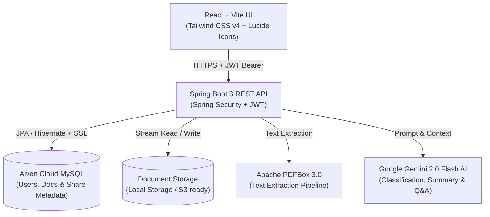

# AI-Powered Digital Document Locker 🗄️⚡

A secure, enterprise-grade web application to upload, organize, search, summarize, and securely share documents with real AI assistance. Built with **React 19 + Vite**, **Spring Boot 3.4**, **Aiven Cloud MySQL**, **Spring Security + JWT**, and **Google Gemini AI**.

---

## 🌟 Key Features

> 📖 **Looking for a step-by-step test guide and demo files?** Check out the [USER_GUIDE.md](file:///d:/au/Academic/TT/ai-document-locker/USER_GUIDE.md) and the [`demo-documents/`](file:///d:/au/Academic/TT/ai-document-locker/demo-documents/) folder!

1. **User Isolation & Security**
   - Stateless JWT Authentication with BCrypt password hashing.
   - Strict multi-tenant isolation: documents are securely isolated per user and cannot be accessed by unauthorized users.
   - Physical documents are stored outside MySQL with sanitized UUID filenames.

2. **Real AI Integration (Google Gemini 2.0 / 1.5 Flash)**
   - **Automated Document Classification**: Categorizes files into `Invoice`, `Resume`, `ID Card`, `Contract`, `Academic`, `Medical`, `Financial`, and `Report`.
   - **Executive Summarization**: Automatically parses files and generates a concise executive summary.
   - **Key Data Extraction**: Identifies and extracts critical metadata such as dates, amounts, parties, and organizations.
   - **Natural Language Querying**: Ask questions across your documents in plain English (e.g. *"What was the total on the Acme invoice?"*) and get generative answers citing matching files.

3. **Apache PDFBox Extraction**
   - High-performance text extraction directly from PDF files and text documents.

4. **Secure Document Sharing**
   - Generate encrypted, tokenized share links.
   - Granular permissions: **View Only** vs. **Allow Download**.
   - Optional link expiration: 1 day, 7 days, 30 days, or permanent.
   - Revoke active share links anytime.

5. **Cloud-Ready Database & Deployment**
   - Works with **Aiven Cloud MySQL** via SSL connection pooling (`sslMode=REQUIRED`).
   - Built-in local H2 / MySQL fallback for offline development.
   - Multi-stage Docker packaging for backend and frontend.

---

## 🏗️ Architecture



---

## 🚀 Getting Started

### Prerequisites
- **Java**: JDK 21 or 24
- **Node.js**: v20+ & **npm**: 10+
- **Maven**: 3.9+ (or use wrapper)

---

### Step 1: Configure Environment Variables
Copy `.env.example` to `.env` or configure your settings:
```bash
# Optional: Set Gemini API key for real AI generation (free from https://aistudio.google.com)
GEMINI_API_KEY=your_gemini_api_key_here

# Optional: Set Aiven Cloud MySQL connection
# SPRING_PROFILES_ACTIVE=aiven
# AIVEN_MYSQL_URL=jdbc:mysql://mysql-xxxxxx.aivencloud.com:12345/defaultdb?sslMode=REQUIRED
# AIVEN_MYSQL_USER=avnadmin
# AIVEN_MYSQL_PASSWORD=your_password
```

---

### Step 2: Run Spring Boot Backend
```bash
cd backend
mvn spring-boot:run
```
The REST API will start on `http://localhost:8080`.
- H2 Console available at: `http://localhost:8080/h2-console`
- Health check endpoint: `http://localhost:8080/api/health`

---

### Step 3: Run React Frontend
In a separate terminal:
```bash
cd frontend
npm install
npm run dev
```
Open `http://localhost:5173` in your browser.
Use the **"Fill Demo Credentials (Alice)"** button to log in with 1-click or register a new user!

---

## 🐳 Docker Deployment

To launch the full application with Docker Compose:
```bash
docker compose up --build
```
- Frontend UI: `http://localhost`
- Backend API: `http://localhost:8080`

---

## 📡 REST API Reference

### Authentication
- `POST /api/auth/register` - Create new user account
- `POST /api/auth/login` - Authenticate and obtain JWT
- `GET /api/auth/me` - Get current authenticated user profile

### Documents
- `POST /api/documents/upload` - Upload file with metadata and run AI analysis
- `GET /api/documents` - List documents (supports `?category=...` and `?query=...`)
- `GET /api/documents/stats` - Document counts, storage used, AI processed count
- `GET /api/documents/{id}` - Get single document details
- `PUT /api/documents/{id}` - Update title, category, or tags
- `DELETE /api/documents/{id}` - Delete document and associated shares
- `GET /api/documents/{id}/file` - Download or preview file

### AI Services
- `POST /api/ai/documents/{id}/reprocess` - Trigger fresh AI analysis
- `POST /api/ai/search` - Natural language query search across locker
- `GET /api/ai/status` - Check Gemini AI configuration status

### Secure Sharing
- `POST /api/documents/{id}/share` - Create share link with permission and expiry
- `GET /api/documents/{id}/shares` - List all shares for document
- `DELETE /api/documents/shares/{shareId}` - Revoke share link
- `GET /api/share/access/{token}` - Public endpoint to view shared document
- `GET /api/share/access/{token}/file` - Public endpoint to download shared file
